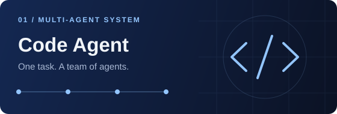
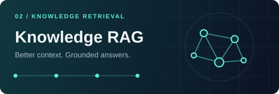
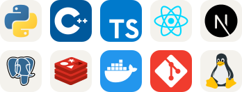

<picture>
  <source media="(prefers-reduced-motion: reduce) and (prefers-color-scheme: dark)" srcset="https://raw.githubusercontent.com/luckyboyo/luckyboyo/main/assets/header-dark-static.svg" />
  <source media="(prefers-reduced-motion: reduce)" srcset="https://raw.githubusercontent.com/luckyboyo/luckyboyo/main/assets/header-static.svg" />
  <source media="(prefers-color-scheme: dark)" srcset="https://raw.githubusercontent.com/luckyboyo/luckyboyo/main/assets/header-dark.svg" />
  
</picture>

  <picture>
    <source media="(prefers-reduced-motion: reduce) and (prefers-color-scheme: dark)" srcset="https://raw.githubusercontent.com/luckyboyo/luckyboyo/main/assets/intro-dark-static.svg" />
    <source media="(prefers-reduced-motion: reduce)" srcset="https://raw.githubusercontent.com/luckyboyo/luckyboyo/main/assets/intro-static.svg" />
    <source media="(prefers-color-scheme: dark)" srcset="https://raw.githubusercontent.com/luckyboyo/luckyboyo/main/assets/intro-dark.svg" />
    
  </picture>

  

  <strong>方子悦 · Fang Ziyue</strong> 
  HKU · Robotics &amp; Intelligent Systems &nbsp; / &nbsp; HFUT · Electronic Information Engineering

<h2>01 &nbsp; About me</h2>

你好，我是<strong>方子悦</strong> 👋 香港大学<strong>机器人与智能系统硕士在读</strong>，本科毕业于合肥工业大学电子信息工程专业。

我关注 <strong>AI Agents、检索增强生成与 AI 应用工程化</strong>。喜欢把复杂任务拆成清晰的工作流，把分散的知识变成可用的上下文，再让想法成为可运行、可验证的应用。

<blockquote>
  
<strong>从理解问题，到构建系统。</strong> 多智能体协作 · 知识检索 · 执行验证 · 持续迭代

</blockquote>

<h2>02 &nbsp; Selected work</h2>

<table>
  <tr>
    <td width="50%" valign="top">
      
      <h3><a href="https://github.com/luckyboyo/Code_agent">Code Agent ↗</a></h3>
      
<strong>让多个 Agent，协作完成一个任务。</strong>

      
用 LangGraph 编排代码探索、编写、评审与测试；通过反馈回路、会话检查点和审计日志，让执行过程可追踪。

      
Python · LangGraph · Redis · PostgreSQL

    </td>
    <td width="50%" valign="top">
      
      <h3><a href="https://github.com/luckyboyo/RAG">Knowledge RAG ↗</a></h3>
      
<strong>让知识被找到，让回答有依据。</strong>

      
融合关键词与向量检索，结合查询理解与父子分块组织上下文，以流式回答和 RAGAS 评估连接体验与质量。

      
Python · pgvector · Streamlit · RAGAS

    </td>
  </tr>
</table>

<h3>Personal website &nbsp; / &nbsp; 个人简历与作品集</h3>

关于我的教育背景、技术经历与项目实践，都放在这里。使用 Next.js、TypeScript 与 Tailwind CSS 构建。

<a href="https://fangziyue.cn"><strong>打开在线简历 ↗</strong></a> &nbsp; · &nbsp; <a href="https://github.com/luckyboyo/resume-site">查看网站源码</a>

<h2>03 &nbsp; Tools I build with</h2>

  <picture>
    <source media="(prefers-color-scheme: dark)" srcset="https://raw.githubusercontent.com/luckyboyo/luckyboyo/main/assets/tech-stack-dark.svg" />
    
  </picture>

  <strong>Agents &amp; Retrieval</strong> 
  LangGraph · LangChain · RAG · pgvector · RAGAS  
  <strong>Applications &amp; Systems</strong> 
  Streamlit · Flask · Docker Compose · ROS 2

  <strong>Stay curious. Build with purpose.</strong> 
  在实践中学习，在迭代中进步。欢迎通过项目 Issues 交流想法。  
  <a href="https://fangziyue.cn">个人网站</a> &nbsp; / &nbsp; <a href="https://github.com/luckyboyo?tab=repositories">全部项目</a>

